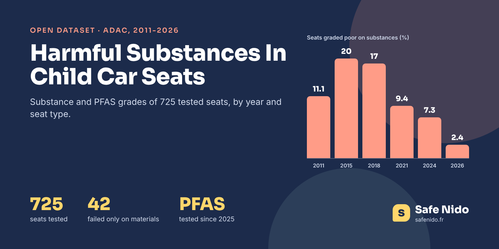

# Harmful Substances In Child Car Seats 2011-2026



[](https://doi.org/10.5281/zenodo.24167260) [](https://www.kaggle.com/datasets/safenido/harmful-substances-in-child-car-seats-2011-2026) [](https://huggingface.co/datasets/safenido/harmful-substances-child-car-seats) [](https://creativecommons.org/licenses/by/4.0/) [](https://www.safenido.fr/)

**English first, version française plus bas.**

Since 2011, ADAC sends the fabrics and plastics of every child car seat to the lab to look for harmful substances, and since 2025 for PFAS too. A bad result downgrades the whole seat. This dataset gives the **substance grades of 725 tests from 2011 to 2026, by year and seat type**, with how many seats failed only because of what they were made of.

### The Headline Numbers

|  |  |
|---|---|
| Tests with a substance grade, 2011-2026 | 725 |
| Seats graded poor on substances | 52 |
| Seats that failed only because of substances | 42 |
| Worst year | 2015, 20% graded poor |
| Since 2025 | PFAS tested, average 1.4 then 1.1 |

Most seats are clean, and the average substance grade improved over the years. But 42 seats were rated poor overall while passing the crash part, only because of their materials. The bad years came in waves, 2015 and 2018 above all, and since PFAS joined the test in 2025, the results on them have been good.

### Files

| file | content |
|---|---|
| `data/harmful_substances_by_year.csv` | 16 rows, one per year |
| `data/harmful_substances_by_seat_type_and_era.csv` | By seat type and protocol era |
| `images/cover.png` | Cover image, 1600 × 800 |

### Columns

**harmful_substances_by_year.csv**

| column | description |
|---|---|
| `year` | Year |
| `tests_with_substance_grade` | Tests with a substance grade |
| `mean_substances_grade` | Average substance grade, 0.5 best to 5.5 worst |
| `substances_very_good, substances_good, substances_satisfactory_or_sufficient, substances_poor` | Seats in each band |
| `share_substances_poor_pct` | Share graded poor on substances |
| `seats_failed_only_because_of_substances` | Seats rated poor overall although the safety part was not poor |
| `tests_with_pfas_grade, pfas_mean_grade` | PFAS results, from 2025 |

**harmful_substances_by_seat_type_and_era.csv**

| column | description |
|---|---|
| `seat_type` | Seat type |
| `protocol_era` | ADAC protocol era |
| `tests` | Tests |
| `mean_substances_grade` | Average substance grade |
| `substances_poor` | Seats graded poor on substances |
| `share_substances_poor_pct` | Share graded poor |

### Load It

```python
import pandas as pd

base = "https://raw.githubusercontent.com/safenido/harmful-substances-child-car-seats/main"
df = pd.read_csv(f"{base}/data/harmful_substances_by_year.csv")
df[["year", "share_substances_poor_pct", "seats_failed_only_because_of_substances"]]
```

### How It Was Built

Built from the substance and PFAS grades of each published ADAC test in the Safe Nido database. A seat counts as failed only because of substances when its overall grade is poor, its substance grade is poor and its safety grade is not.

### Checked Against The Source

The yearly totals add up to the 725 tests with a substance grade, and the failures match the companion sessions dataset.

### Read With Care

- **Not tested before 2011.**
- **Lab tests on one sample.** A later batch of the same model can differ.
- **Averages only**, no individual result is published.

### License And Citation

**[CC BY 4.0](https://creativecommons.org/licenses/by/4.0/)**. Use it, share it and adapt it, commercially or not, and credit **Safe Nido** with a link to **[safenido.fr](https://www.safenido.fr/)**, along with the original source below.

```bibtex
@misc{safenido_harmful_substances_child_car_seats_2026,
  title  = {Harmful Substances In Child Car Seats 2011-2026},
  author = {{Safe Nido}},
  year   = {2026},
  doi    = {10.5281/zenodo.24167260},
  url    = {https://github.com/safenido/harmful-substances-child-car-seats},
  note   = {Dataset, version 1.0}
}
```

Source. Published results of the ADAC and ÖAMTC child seat tests, aggregated by Safe Nido, https://www.safenido.fr/sieges-auto-a-eviter/

Archived on **[Zenodo](https://doi.org/10.5281/zenodo.24167260)** with a permanent DOI, 10.5281/zenodo.24167260.

Companion datasets, **[Child Car Seat Crash Test Statistics 2007-2026](https://github.com/safenido/child-car-seat-crash-test-statistics)** ([Kaggle](https://www.kaggle.com/datasets/safenido/child-car-seat-crash-test-statistics-2007-2026), [Hugging Face](https://huggingface.co/datasets/safenido/child-car-seat-crash-test-statistics)), **[ADAC Child Car Seat Test Sessions 2007-2026](https://github.com/safenido/adac-child-seat-test-sessions)** ([Kaggle](https://www.kaggle.com/datasets/safenido/adac-child-car-seat-test-sessions-2007-2026), [Hugging Face](https://huggingface.co/datasets/safenido/adac-child-seat-test-sessions)). All Safe Nido datasets are listed in **[Child Passenger Safety Datasets](https://github.com/safenido/child-passenger-safety-datasets)**.

Also on **[GitHub](https://github.com/safenido/harmful-substances-child-car-seats)**, **[Kaggle](https://www.kaggle.com/datasets/safenido/harmful-substances-in-child-car-seats-2011-2026)** with a starter notebook, and **[Hugging Face](https://huggingface.co/datasets/safenido/harmful-substances-child-car-seats)**, ready for the `datasets` library.

### On Safe Nido

The data behind these files is used on [Safe Nido](https://www.safenido.fr/), an independent French guide to child car seats built on twenty years of crash tests.

- [Seats to avoid](https://www.safenido.fr/sieges-auto-a-eviter/)
- [Every ADAC result](https://www.safenido.fr/test-adac/)
- [Seats with no crash test](https://www.safenido.fr/guides/barometre-sieges-auto-sans-crash-test/)

---

## Version Française

### Les Substances Nocives Dans Les Sièges Auto, 2011-2026

Les résultats des tests de substances nocives et de PFAS de l'ADAC sur 725 sièges depuis 2011, par année et par type de siège. 42 sièges ont été notés insuffisants uniquement à cause de leurs matériaux, alors que leur partie sécurité tenait.

Licence CC BY 4.0, en citant **Safe Nido** et un lien vers **[safenido.fr](https://www.safenido.fr/)**. Retrouvez les guides et les fiches des sièges sur [Safe Nido](https://www.safenido.fr/).
